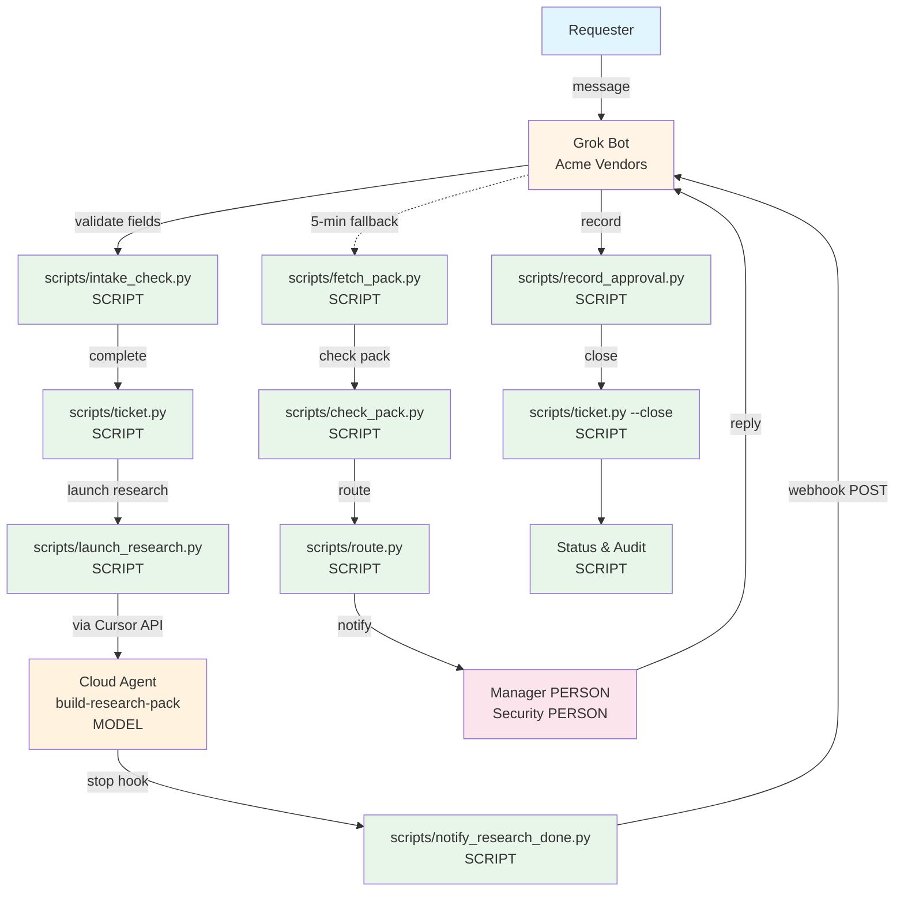

# Acme Vendor Onboarding Automation

Governed workflow for vendor onboarding: intake → research pack → approval routing. Built with Grok Bot and Grok Build (Cursor), using public and synthesized data only.

---

## The Problem

**Maya Chen (Staff Ops, Acme)** owns vendor onboarding. Current process takes 1-2 weeks. Leadership wants 1-2 days with clear audit trails.

### Four Friction Points

**1. Messy intake**
- Email or ticket: "Onboard Vendor X for a 90-day pilot"
- Five required fields often incomplete: vendor legal name, website, customer data flag, business owner, target start date
- Ops chases missing fields over days of back-and-forth

**2. Manual research copy/paste**
- Ops manually gathers public vendor info (website, security page, pricing) into shared doc
- No standard template or checklist
- Inconsistent and time-consuming

**3. Late and unclear approvals**
- Manager reviews whenever they notice the thread (no proactive routing)
- Security pinged late, only if vendor touches customer data
- No single status view
- No audit trail

**4. Cycle time too long**
- End-to-end typically 1-2 weeks
- Leadership wants 1-2 days with clear records

### Concerns by Role

**Line of Business (LOB)**
- "How do I check status without hunting through email?"
- "Why does it take a week to get approval for a standard tool?"

**Security**
- "I need to see what data the vendor would hold before I approve"
- "Where's the audit trail showing who checked what and when?"

**Engineering**
- "Can we automate the research without touching private data?"
- "How do we track cost and prevent runaway API spend?"

---

## Architecture



**Label Legend:** SCRIPT = script runs locally | MODEL = cloud agent or bot | PERSON = human checkpoint

---

## Bot Design

Grok Bot (Acme Vendors) is the front door. Every action is backed by a script that enforces the rules. The bot words the question; the script decides what's missing.

| User Action | Script Run | Actor | Human Checkpoint |
|-------------|------------|-------|------------------|
| **Intake** | | | |
| Requester sends "Onboard Zendesk for 90-day pilot..." | `scripts/intake_check.py` validates five fields | SCRIPT | None (validation only) |
| Bot asks follow-up for missing fields (max 2 rounds) | `scripts/followup.py` picks questions | SCRIPT | Requester answers |
| Bot creates ticket when complete | `scripts/ticket.py` writes JSON | SCRIPT | None |
| **Research** | | | |
| Bot launches cloud agent via Cursor API | `scripts/launch_research.py` | SCRIPT → MODEL | None (dry run by default, --live flag required) |
| Cloud agent fetches public vendor pages | `.cursor/skills/build-research-pack` | MODEL | None (public sources only) |
| Agent stops → webhook notifies bot | `.cursor/hooks.json` → `scripts/notify_research_done.py` | SCRIPT | None |
| Bot falls back to polling every 5 min | `scripts/fetch_pack.py` checks agent status | SCRIPT | None |
| Bot validates pack against checklist | `scripts/check_pack.py` (R1-R11, source URLs) | SCRIPT | Requester reviews pack summary |
| **Approvals** | | | |
| Bot routes to manager (always) + Security (if customer data) | `scripts/route.py` | SCRIPT | None |
| Bot notifies each approver with pack summary | `scripts/request_approvals.py` | SCRIPT | Manager + Security review |
| Approver replies in their own words | Bot presents reply | BOT → PERSON | Bot never decides; person decides |
| Bot records decision with name + exact quote | `scripts/record_approval.py` | SCRIPT | None (recording only) |
| **Close-out** | | | |
| Requester withdraws request | `python3 -m scripts.ticket --withdraw <id> --by "<name>" --reason "<text>"` | PERSON | Requester's own words; script records it |
| Bot closes when all approvers decided | `scripts/ticket.py --close` | SCRIPT | None |
| **Status & Maintenance** | | | |
| Anyone asks bot "What's the status of VR-0001?" | `scripts/status.py` reads ticket + audit | SCRIPT | None |
| Bot nudges stale approvals (silence ≠ yes) | `scripts/stale_check.py` (configured hours) | SCRIPT | Approver gets reminder |
| Bot sends daily digest to Ops | `scripts/digest.py` lists open requests | SCRIPT | Ops reviews exceptions |

### Bot Prompt Rules (Key Constraints)

The bot **CAN**:
- Collect the five required intake fields
- Ask follow-up questions (max 2 rounds) for missing or invalid fields
- Launch research via Cursor API with `--live` flag
- Present research pack summary to requester and approvers
- Record approver decisions with name, decision, timestamp, exact quote
- Generate status reports and daily digest

The bot **CANNOT**:
- Approve a vendor (only named people approve)
- Guess or invent missing intake fields
- Fill in approver name or decision on someone's behalf
- Send email outside the bot interface
- Touch private data or vendor portals
- Run research without `--live` flag (dry run by default)

### Guardrails (Four Layers)

**1. Impossible (technical blocks)**
- Bot has no email integration (cannot send external email)
- Bot has no write access to private data sources
- Cloud agent can only fetch public URLs (no logins, no gated portals)
- Approval decisions stored with hash of intake + pack; changes invalidate approval

**2. Check (script validation before action)**
- `scripts/intake_check.py` validates all five fields before routing
- `scripts/check_pack.py` validates R1, R3, R4, R10 present and every row has source URL
- `scripts/route.py` gates on intake complete + pack complete + business owner is named person
- `scripts/check_pack.py` cross-checks intake `touches_customer_data` vs pack R3

**3. Rule (documented policy in `.cursor/rules/`)**
- `intake-policy.mdc`: Five fields, valid values, max 2 follow-up rounds
- `research-checklist.mdc`: R1-R11 items, must-haves, public sources only
- `approval-policy.mdc`: Manager always, Security when customer data, silence never counts
- `data-boundaries.mdc`: Public sources only, no NDA content, no API keys in repo

**4. Person (human decision point)**
- Requester confirms vendor and pilot details before research launches
- Requester reviews pack summary (especially "not found" items)
- Manager and Security approve or reject in their own words
- Ops reviews daily digest (open requests, exceptions, days open)

---

## Build: Folder Layout

```
acme-vendor-onboarding/
├── scripts/                    # Python scripts (intake, routing, approvals, audit, status, Cursor API)
│   ├── intake_check.py         # Validate five fields
│   ├── followup.py             # Pick follow-up questions
│   ├── ticket.py               # Create and close tickets
│   ├── launch_research.py      # Launch cloud agent via Cursor API (dry run by default, --live flag)
│   ├── fetch_pack.py           # Fetch pack from agent reply
│   ├── check_pack.py           # Validate pack against checklist
│   ├── route.py                # Route to manager + Security (conditional)
│   ├── request_approvals.py    # Notify approvers
│   ├── record_approval.py      # Record decision (name, decision, timestamp, quote)
│   ├── status.py               # Generate status from ticket + audit
│   ├── stale_check.py          # List approvals due a nudge
│   ├── digest.py               # Daily Ops digest
│   ├── notify_research_done.py # Webhook notification on agent stop
│   └── run.py                  # Trace one sample through every step (make run)
├── tests/                      # Unit tests (make test)
├── data/samples/               # Sample vendor requests (synthesized)
│   ├── vr-0001-zendesk.json    # Worked example (messy intake, one follow-up, manager + Security)
│   ├── vr-0002-figma.json      # Clean request (no follow-ups, manager only)
│   └── vr-0003-asana.json      # Exception (missing business owner)
├── templates/                  # Research pack template
│   └── research_pack.json      # R1-R11 items
├── config/                     # Approval settings (nudge after N hours)
├── tickets/                    # One JSON file per request (output, git-ignored)
├── packs/                      # Research packs (output, git-ignored)
├── runs/                       # Audit logs and agent run files (output, git-ignored)
├── .cursor/
│   ├── rules/                  # Cursor rules (8 files)
│   │   ├── data-boundaries.mdc # Public sources only, no NDA, no secrets in repo
│   │   ├── intake-policy.mdc   # Five fields, valid values, max 2 follow-ups
│   │   ├── research-checklist.mdc # R1-R11 items, must-haves, source URLs required
│   │   ├── approval-policy.mdc # Manager always, Security conditional, silence ≠ yes
│   │   ├── status-and-audit.mdc # Days open, exception count, audit log format
│   │   ├── git-workflow.mdc    # Branch + PR policy, commit hygiene
│   │   ├── pr-style.mdc        # Plain title, ready for review, under 200 words
│   │   └── verification.mdc    # Tests call scripts on samples, assert expected values
│   ├── skills/                 # Skills (3)
│   │   ├── validate-intake/    # Check five fields, pick follow-ups
│   │   ├── build-research-pack/ # Gather R1-R11 from public sources
│   │   └── verify-acme/        # Verify sample data is [SYNTHESIZED] or [PUBLIC]
│   └── hooks.json              # Stop hook → notify_research_done.py
├── Makefile                    # make setup, test, run, validate, route, status, audit, clean
├── AGENTS.md                   # Agent guidelines (git workflow, data boundaries, approval policy)
└── README.md                   # This file
```

### Rules vs Scripts

**Rules explain policy** (`.cursor/rules/*.mdc`): five required fields, what counts as valid, who must approve, what "enough research" means, data boundaries.

**Scripts enforce the rules** (`scripts/*.py`): validate intake, check pack, route approvals, record decisions, generate audit log.

The bot reads the rules to word follow-up questions and pack summaries. The scripts are the source of truth for validation and routing.

---

## Real Run: VR-0010 RevenueCat

Request received **2026-10-11 10:37 PT**, closed **2026-10-11 10:45 PT** (8 minutes).

**Requester:** Jordan Lee [SYNTHESIZED], Growth Product Manager  
**Vendor:** RevenueCat (revenuecat.com) – in-app subscription platform  
**Pilot:** 90 days, iOS app integration  
**Customer data:** Yes (purchase history, subscriber IDs, device IDs)

**Intake:** Complete in one round (no follow-ups needed).

**Research pack:** Built via cloud agent in 4 minutes. All must-haves found (R1, R3, R4, R10). Two "not found" items: R5 (SOC 2 report access) and R7 (data residency options).

**Routing:** Manager + Security (customer data = yes).

**Approvals:**
- Manager (Alex Rivera [SYNTHESIZED], VP Product): approved, 2026-10-11 10:42 PT
- Security (Lena Hoffmann [SYNTHESIZED], Security & GRC Lead): approved with conditions, 2026-10-11 10:45 PT
  - Conditions: "DPA signed before integration" and "Request SOC 2 Type II report under NDA before production use"

**Audit log** (`runs/VR-0010/audit.csv`) **actor_type column**:
- 1 person (requester)
- 10 script (intake, follow-up, ticket, fetch, check, route, record × 2, close, status)
- 4 model (cloud agent research)
- 2 person (manager + Security approvals)

**Both conditions** recorded in ticket and audit log, carried forward to requester as checklist.

**Days open:** 0.0 (same day).  
**Exceptions:** 2 (two "not found" pack rows: R5, R7).

---

## Mocked vs Synthesized vs Live

| Component | Status | Notes |
|-----------|--------|-------|
| **Grok Bot intake** | Live | Acme Vendors bot; `make run` replays sample messages |
| **Field validation** | Live | `scripts/intake_check.py`, runs locally |
| **Follow-up picker** | Live | `scripts/followup.py`, runs locally |
| **Research pack template** | Live | `templates/research_pack.json` (R1-R11) |
| **Pack checker** | Live | `scripts/check_pack.py`, validates must-haves + source URLs |
| **Cloud agent (via API)** | Live | Cursor API with `--live` flag; dry run by default |
| **Public data sources** | Live | Real vendor websites, trust pages, pricing (public only) |
| **Webhook notification** | Live | `.cursor/hooks.json` stop hook → `scripts/notify_research_done.py` |
| **Sample requesters & approvers** | Synthesized | Fictional Acme people, labeled `[SYNTHESIZED]` in `data/samples/` |
| **Sample vendors** | Mixed | Real public companies (Zendesk, Figma, Asana, RevenueCat); pilot details synthesized |
| **Zendesk research pack** | Public | Hand-run from public pages 2026-10-08; kept as expected pack in samples |
| **Approval routing** | Live | `scripts/route.py`, runs locally |
| **Approval recorder** | Live | `scripts/record_approval.py`, runs locally |
| **Audit log** | Live | `scripts/status.py` appends rows, runs locally |
| **Status generator** | Live | `scripts/status.py` reads ticket + audit, runs locally |
| **Manager approvals in bot** | Live | Real humans in production; played by Matt in demo |
| **Security approvals in bot** | Live | Real Security team in production; played by Matt in demo |
| **Approvals in `make run`** | Mocked | Pre-set `approver_replies` in `data/samples/` |

---

## How to Run

Python 3.9 or newer. No pip installs. Run every command from repo root.

### 1. Set up

```bash
make setup
```

Output: `✓ Project structure ready`

### 2. Test

```bash
make test
```

Without make: `python3 -m unittest discover -s tests -v`. Last line should be `OK`.

### 3. Trace one sample

```bash
make run SAMPLE=zendesk
make run SAMPLE=figma
make run SAMPLE=asana
```

Each step prints one numbered line, labeled `[script]`, `[model]`, or `[person]`.

- `zendesk`: Worked example (one follow-up round, manager + Security, approved with conditions)
- `figma`: Clean request (no follow-ups, manager only, approved)
- `asana`: Exception (missing business owner, chased in round 1)

`make run` is always a dry run: no network, no key. Temp folders printed in steps 3 and 8.

### 4. Step by step

These write to `tickets/`, `packs/`, and `runs/` (git-ignored).

```bash
python3 -m scripts.ticket zendesk
python3 -m scripts.launch_research --ticket VR-0001
python3 -m scripts.fetch_pack --ticket VR-0001 --reply-file <saved reply>
python3 -m scripts.status --ticket VR-0001
```

1. `scripts.ticket` writes `tickets/VR-0001.json`
2. `scripts.launch_research` prints Cursor API request (dry run)
3. `scripts.fetch_pack` pulls pack from agent reply into `packs/VR-0001/`, writes to ticket if pack check passes
4. `scripts.status` prints status from ticket and `runs/VR-0001/audit.csv`

### 5. Approvals, close-out, maintenance

```bash
python3 -m scripts.request_approvals --ticket VR-0001
python3 -m scripts.record_approval --ticket VR-0001 --role manager --name "<name>" --decision approved --quote "<exact words>"
python3 -m scripts.ticket --close VR-0001
python3 -m scripts.stale_check [--record]
python3 -m scripts.digest
```

1. `scripts.request_approvals` routes ticket, records when each request went out
2. `scripts.record_approval` only records decision a named person already gave. `--decision` is `approved`, `approved_with_conditions`, or `rejected`. Repeat `--condition` for each condition.
3. `scripts.ticket --close` records final decision once every approver decided
4. `scripts.stale_check` lists approvals due a nudge. Silence ≠ yes. `--record` writes nudges to ticket and audit log.
5. `scripts.digest` prints daily Ops digest of every open request

Add `--help` to any command for options and examples.

### Dry run vs live

Dry run is default everywhere. `--live` is the only way to spend money. Key comes only from `CURSOR_API_KEY` environment variable, never from file or flag.

```bash
python3 -m scripts.launch_research --ticket VR-0001 --live
python3 -m scripts.fetch_pack --ticket VR-0001 --live
```

Run `launch_research --live`, wait for agent, then run `fetch_pack --live`. If `fetch_pack` exits code 3, agent still running; run again later.

### Research completion webhook

When research agent stops, webhook notifies vendor bot immediately instead of waiting for 5-minute polling check. Hook runs automatically via `.cursor/hooks.json`.

Set these environment variables as Cursor cloud agent secrets:

- `ACME_WEBHOOK_URL`: Webhook endpoint URL
- `ACME_WEBHOOK_SECRET`: Secret key sent in webhook header
- `ACME_WEBHOOK_KEY_HEADER` (optional): Header name for secret (default: `X-Webhook-Key`)

Webhook POSTs JSON: `{"ticket_id": "VR-0001", "status": "completed"}`. Never sends pack contents. Hook always exits successfully, never fails agent run. If URL or secret not set, hook does nothing. 5-minute polling remains as fallback.

### Live flags

**Intake and routing:** Always live (local scripts, no API calls).

**Research:** `--live` required for Cursor API calls (costs money).

**Approvals in bot:** Live (real people respond). In `make run`: mocked (pre-set replies in samples).

---

## Tradeoffs and Next Steps

### Tradeoffs

**Condition tracking before start date**
- Current: Conditions recorded in ticket and audit log, presented to requester as checklist
- Bot does not track completion of conditions or block start date if incomplete
- Next: Add condition status field (`pending`, `complete`, `waived`) and workflow to mark each complete before start date

**JSON tickets vs Jira/ServiceNow**
- Current: Local JSON files in `tickets/` (git-ignored), no external system integration
- Works for demo and pilot, but Ops likely wants one place for all vendor requests
- Next: Connect to Jira or ServiceNow as system of record, scripts read/write tickets there

**Key rotation**
- Current: `CURSOR_API_KEY` lives in environment variable as Cursor cloud agent secret
- No rotation policy, no expiration tracking
- Next: Rotate key every 90 days, store rotation date in config, alert when expiring

**Pilot cost estimates**
- Current: Hand-calculated from public pricing (labeled `[ASSUMPTION]`)
- No budget approval gate before routing to manager
- Next: Add budget threshold (e.g. pilots > $5k need Finance approval before manager)

**Duplicate vendor detection**
- Current: Each request treated independently, no check for existing pilot or active contract
- Risk: Two teams pilot same vendor concurrently, duplicate spend
- Next: Check `tickets/` for open or approved requests for same vendor, flag to Ops

**Email notifications**
- Current: All communication in bot, no email integration
- Approvers must check bot for new requests, no external reminder
- Next: Optional email notification when routed, but keep approvals in bot (not via email reply)

### Next Steps

1. **Validate with Maya:** Confirm five fields sufficient, research checklist complete, approval routing correct
2. **Run live pilot:** Pick 3-5 real vendor requests, run with `--live` flag, track cycle time and exceptions
3. **Connect Jira/ServiceNow:** Replace JSON tickets with external system integration
4. **Add condition tracking:** Mark conditions complete before start date
5. **Rotate API key:** Set 90-day rotation policy, add expiration alert
6. **Budget approval gate:** Route pilots > $5k to Finance before manager
7. **Duplicate detection:** Check for existing vendor pilots before creating new request

---

## Development Workflow

See `.cursor/rules/git-workflow.mdc` and `AGENTS.md` for full details.

**Summary:**
- Work on a new branch for every change
- Open a pull request for Matt to review
- Never commit or push directly to `main`
- Never merge your own pull request
- Never force-push
- Write small, focused commits with clear messages explaining **why**

---

## License

Internal Acme project. Not open source.
