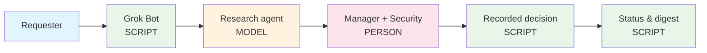
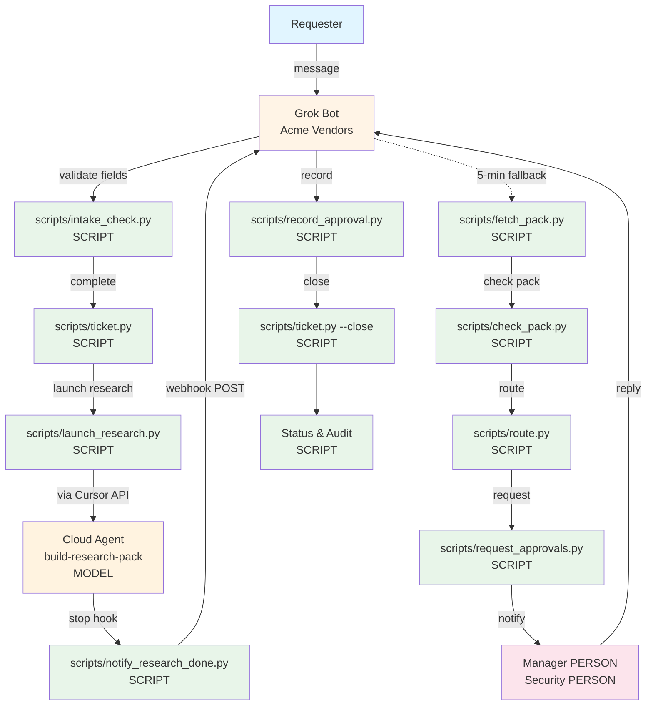

# Acme Vendor Onboarding Automation

Governed workflow for vendor onboarding: intake → research pack → approval routing. Built with Grok Bot and Grok Build (Cursor), using public and synthesized data only.

---

## The 5-minute version

**Problem:** Maya Chen (Staff Ops) owns vendor onboarding. Current process takes 1-2 weeks (messy intake, manual research, late approvals). Leadership wants 1-2 days with clear audit trails.

**Flow:**



**What happens:**

| You say | What runs | Who decides |
|---------|-----------|-------------|
| "Onboard Zendesk for 90-day pilot..." | Bot validates 5 fields (SCRIPT) | Requester answers follow-ups |
| "Launch research" | Cloud agent fetches public pages (MODEL) | None (public sources only) |
| (Pack ready) | Bot presents pack summary | Requester reviews |
| (Route for approval) | Bot notifies manager + Security if customer data (SCRIPT) | Manager + Security approve/reject |
| "Approved" or "Rejected" | Bot records decision with name + quote (SCRIPT) | None (recording only) |
| "Close ticket" | Bot closes when all approvers decided (SCRIPT) | None |
| "What's the status?" | Bot reads ticket + audit log (SCRIPT) | None |
| (Silence from approver) | Bot nudges after configured hours (SCRIPT) | Ops reviews |

**Guardrails:**
- **Impossible:** Bot has no email, no private data access. Approvals stored with hash; changes invalidate.
- **Check:** Scripts validate 5 fields, check pack (R1/R3/R4/R10 + source URLs), gate routing, cross-check intake vs R3.
- **Rule:** `.cursor/rules/` define policy (5 fields, R1-R11, manager always + Security when customer data, public sources only).
- **Person:** Requester confirms before research. Manager + Security approve in their own words. Ops reviews digest.

**Proof (VR-0010 RevenueCat):** Opened 10:37:41 PT, closed 10:45:00 PT (~7 min). Requester: Matt Snow (demo requester, recorded as Support Lead). Pack: 10:37:50–10:41:29 (~3.5 min), check PASS (12 rows, 0 not found). Approvals: Daniel Okafor + Lena Hoffmann (both approved_with_conditions). Audit: 7 rows (4 script, 1 model, 2 person). Exceptions: 0.

**Mocked / Synthesized / Live:**

| Component | Status | Notes |
|-----------|--------|-------|
| **Bot, scripts, cloud agent** | Live | Real Grok Bot, local Python scripts, Cursor API (`--live` flag) |
| **Sample requesters, approvers, pilot details** | Synthesized | Fictional Acme people labeled `[SYNTHESIZED]` in `data/samples/` |
| **Vendor websites, public pricing, trust pages** | Live | Real public pages (Zendesk, Figma, Asana, RevenueCat) |

Security cares about what agents can touch, LOB leaders care about cycle time and exception rate, and eng cares about integrations and ownership.

---

## Reference (details below)

<details><summary>Owners</summary>

| Role | Owner | Notes |
|------|-------|-------|
| **Ops** | Maya Chen [SYNTHESIZED] | Staff Ops; owns vendor onboarding process |
| **Security** | Lena Hoffmann [SYNTHESIZED] | Security & GRC Lead; approves when vendor touches customer data |
| **Eng** | Eng [SYNTHESIZED] | Repository owner; maintains automation |

</details>

<details><summary>Detailed Flow</summary>



**Label Legend:** SCRIPT = script runs locally | MODEL = cloud agent or bot | PERSON = human checkpoint

</details>

<details><summary>Bot Actions</summary>

| User Action | Script Run | Actor | Human Checkpoint |
|-------------|------------|-------|------------------|
| **Intake** | | | |
| Requester sends "Onboard Zendesk for 90-day pilot..." | `scripts/intake_check.py` validates five fields | SCRIPT | None (validation only) |
| Bot asks follow-up for missing fields (max 2 rounds) | `scripts/followup.py` picks questions | SCRIPT | Requester answers |
| Bot creates ticket when complete | `scripts/ticket.py` writes JSON | SCRIPT | None |
| **Research** | | | |
| Bot launches cloud agent via Cursor API | `scripts/launch_research.py` | SCRIPT → MODEL | None (dry run by default, --live flag required) |
| Cloud agent fetches public vendor pages | `.cursor/skills/build-research-pack` | MODEL | None (public sources only) |
| Agent stops → webhook notifies bot | `.cursor/hooks.json` → `scripts/notify_research_done.py` | SCRIPT | None |
| Bot falls back to polling every 5 min | `scripts/fetch_pack.py` checks agent status | SCRIPT | None |
| Bot validates pack against checklist | `scripts/check_pack.py` (R1-R11, source URLs) | SCRIPT | Requester reviews pack summary |
| **Approvals** | | | |
| Bot routes to manager (always) + Security (if customer data) | `scripts/route.py` | SCRIPT | None |
| Bot notifies each approver with pack summary | `scripts/request_approvals.py` | SCRIPT | Manager + Security review |
| Approver replies in their own words | Bot presents reply | BOT → PERSON | Bot never decides; person decides |
| Bot records decision with name + exact quote | `scripts/record_approval.py` | SCRIPT | None (recording only) |
| **Close-out** | | | |
| Requester withdraws request | `python3 -m scripts.ticket --withdraw <id> --by "<name>" --reason "<text>"` | PERSON | Requester's own words; script records it |
| Bot closes when all approvers decided | `scripts/ticket.py --close` | SCRIPT | None |
| **Status & Maintenance** | | | |
| Anyone asks bot "What's the status of VR-0001?" | `scripts/status.py` reads ticket + audit | SCRIPT | None |
| Bot nudges stale approvals (silence ≠ yes) | `scripts/stale_check.py` (configured hours) | SCRIPT | Approver gets reminder |
| Bot sends daily digest to Ops | `scripts/digest.py` lists open requests | SCRIPT | Ops reviews exceptions |

</details>

<details><summary>Bot Capabilities</summary>

The bot **CAN**:
- Collect the five required intake fields
- Ask follow-up questions (max 2 rounds) for missing or invalid fields
- Launch research via Cursor API with `--live` flag
- Present research pack summary to requester and approvers
- Record approver decisions with name, decision, timestamp, exact quote
- Generate status reports and daily digest

The bot **CANNOT**:
- Approve a vendor (only named people approve)
- Guess or invent missing intake fields
- Fill in approver name or decision on someone's behalf
- Send email outside the bot interface
- Touch private data or vendor portals
- Run live research (research is a dry run unless --live)

</details>

<details><summary>Guardrails (Four Layers)</summary>

**1. Impossible (technical blocks)**
- Bot has no email integration (cannot send external email)
- Bot has no write access to private data sources
- Approval decisions stored with hash of intake + pack; changes invalidate approval

**2. Check (script validation before action)**
- `scripts/intake_check.py` validates all five fields before routing
- `scripts/check_pack.py` validates R1, R3, R4, R10 present and every row has source URL
- `scripts/route.py` gates on intake complete + pack complete + business owner is named person
- `scripts/route.py` cross-checks intake `touches_customer_data` vs pack R3 (mismatch routes to Security)

**3. Rule (documented policy in `.cursor/rules/`)**
- `intake-policy.mdc`: Five fields, valid values, max 2 follow-up rounds
- `research-checklist.mdc`: R1-R11 items, must-haves, public sources only
- `approval-policy.mdc`: Manager always, Security when customer data, silence never counts
- `data-boundaries.mdc`: Public sources only, no NDA content, no API keys in repo, cloud agent public URLs only

**4. Person (human decision point)**
- Requester confirms vendor and pilot details before research launches
- Requester reviews pack summary (especially "not found" items)
- Manager and Security approve or reject in their own words
- Ops reviews daily digest (open requests, exceptions, days open)

</details>

<details><summary>Folder Layout</summary>

```
acme-vendor-onboarding/
├── scripts/                    # Python scripts (intake, routing, approvals, audit, status, Cursor API)
├── tests/                      # Unit tests (make test)
├── data/samples/               # Sample vendor requests (synthesized)
├── templates/                  # Research pack template
├── config/                     # Approval settings (nudge after N hours)
├── tickets/                    # One JSON file per request (output, git-ignored)
├── packs/                      # Research packs (output, git-ignored)
├── runs/                       # Audit logs and agent run files (output, git-ignored)
├── .cursor/
│   ├── rules/                  # Cursor rules (8 files)
│   ├── skills/                 # Skills (3)
│   └── hooks.json              # Stop hook → notify_research_done.py
├── Makefile                    # make setup, test, run, validate, route, status, audit, clean
├── AGENTS.md                   # Agent guidelines (git workflow, data boundaries, approval policy)
└── README.md                   # This file
```

</details>

<details><summary>Rules vs Scripts</summary>

**Rules explain policy** (`.cursor/rules/*.mdc`): five required fields, what counts as valid, who must approve, what "enough research" means, data boundaries.

**Scripts enforce the rules** (`scripts/*.py`): validate intake, check pack, route approvals, record decisions, generate audit log.

The bot reads the rules to word follow-up questions and pack summaries. The scripts are the source of truth for validation and routing.

</details>

<details><summary>Full VR-0010 Details</summary>

Request opened **2026-10-11 10:37:41 PT**, closed **10:45:00 PT** (~7 minutes).

**Requester:** Matt Snow (demo requester, recorded as Support Lead)  
**Vendor:** RevenueCat  

**Intake:** passed (5 fields).

**Research pack:** Built via cloud agent 10:37:50–10:41:29 (~3.5 minutes). Pack check: **PASS** (12 rows, 0 not found).

**Routing:** Manager + Security (customer data = yes).

**Approvals:**
- **Daniel Okafor** [SYNTHESIZED], Director of Customer Support: **approved_with_conditions**, 2026-10-11 10:44 PT  
  - Condition: "AI sub-processors (OpenAI, Anthropic) reviewed before customer data goes in"
- **Lena Hoffmann** [SYNTHESIZED], Security & GRC Lead: **approved_with_conditions**, 2026-10-11 10:45 PT  
  - Condition: "Need to review subprocessors first"

**Audit log** (`runs/VR-0010/audit.csv`):
- 7 rows total: 4 script, 1 model, 2 person

**Days open:** 0.0 (same day).  
**Exceptions:** 0.

</details>

<details><summary>Component Status (Complete)</summary>

| Component | Status | Notes |
|-----------|--------|-------|
| **Grok Bot intake** | Live | Acme Vendors bot; `make run` replays sample messages |
| **Field validation** | Live | `scripts/intake_check.py`, runs locally |
| **Follow-up picker** | Live | `scripts/followup.py`, runs locally |
| **Research pack template** | Live | `templates/research_pack.json` (R1-R11) |
| **Pack checker** | Live | `scripts/check_pack.py`, validates must-haves + source URLs |
| **Cloud agent (via API)** | Live | Cursor API with `--live` flag; dry run by default |
| **Public data sources** | Live | Real vendor websites, trust pages, pricing (public only) |
| **Webhook notification** | Live | `.cursor/hooks.json` stop hook → `scripts/notify_research_done.py` |
| **Sample requesters & approvers** | Synthesized | Fictional Acme people, labeled `[SYNTHESIZED]` in `data/samples/` |
| **Sample vendors** | Mixed | Real public companies (Zendesk, Figma, Asana, RevenueCat); pilot details synthesized |
| **Zendesk research pack** | Public | Hand-run from public pages 2026-10-08; kept as expected pack in samples |
| **Approval routing** | Live | `scripts/route.py`, runs locally |
| **Approval recorder** | Live | `scripts/record_approval.py`, runs locally |
| **Audit log** | Live | `scripts/status.py` appends rows, runs locally |
| **Status generator** | Live | `scripts/status.py` reads ticket + audit, runs locally |
| **Manager approvals in bot** | Live | Real humans in production; played by Matt in demo |
| **Security approvals in bot** | Live | Real Security team in production; played by Matt in demo |
| **Approvals in `make run`** | Mocked | Pre-set `approver_replies` in `data/samples/` |

</details>

---

## How to Run

Python 3.9 or newer. No pip installs. Run every command from repo root.

### 1. Set up

```bash
make setup
```

Output: `✓ Project structure ready`

### 2. Test

```bash
make test
```

Without make: `python3 -m unittest discover -s tests -v`. Last line should be `OK`.

### 3. Trace one sample

```bash
make run SAMPLE=zendesk
make run SAMPLE=figma
make run SAMPLE=asana
```

Each step prints one numbered line, labeled `[script]`, `[model]`, or `[person]`.

- `zendesk`: Worked example (one follow-up round, manager + Security, approved with conditions)
- `figma`: Clean request (no follow-ups, manager only, approved)
- `asana`: Exception (missing business owner, chased in round 1)

`make run` is always a dry run: no network, no key. Temp folders printed in steps 3 and 8.

### 4. Step by step

These write to `tickets/`, `packs/`, and `runs/` (git-ignored).

```bash
python3 -m scripts.ticket zendesk
python3 -m scripts.launch_research --ticket VR-0001
python3 -m scripts.fetch_pack --ticket VR-0001 --reply-file <saved reply>
python3 -m scripts.status --ticket VR-0001
```

1. `scripts.ticket` writes `tickets/VR-0001.json`
2. `scripts.launch_research` prints Cursor API request (dry run)
3. `scripts.fetch_pack` pulls pack from agent reply into `packs/VR-0001/`, writes to ticket if pack check passes
4. `scripts.status` prints status from ticket and `runs/VR-0001/audit.csv`

### 5. Approvals, close-out, maintenance

```bash
python3 -m scripts.request_approvals --ticket VR-0001
python3 -m scripts.record_approval --ticket VR-0001 --role manager --name "<name>" --decision approved --quote "<exact words>"
python3 -m scripts.ticket --close VR-0001
python3 -m scripts.stale_check [--record]
python3 -m scripts.digest
```

1. `scripts.request_approvals` routes ticket, records when each request went out
2. `scripts.record_approval` only records decision a named person already gave. `--decision` is `approved`, `approved_with_conditions`, or `rejected`. Repeat `--condition` for each condition.
3. `scripts.ticket --close` records final decision once every approver decided
4. `scripts.stale_check` lists approvals due a nudge. Silence ≠ yes. `--record` writes nudges to ticket and audit log.
5. `scripts.digest` prints daily Ops digest of every open request

Add `--help` to any command for options and examples.

### Dry run vs live

Dry run is default everywhere. `--live` is the only way to spend money. Key comes only from `CURSOR_API_KEY` environment variable, never from file or flag.

```bash
python3 -m scripts.launch_research --ticket VR-0001 --live
python3 -m scripts.fetch_pack --ticket VR-0001 --live
```

Run `launch_research --live`, wait for agent, then run `fetch_pack --live`. If `fetch_pack` exits code 3, agent still running; run again later.

### Research completion webhook

When research agent stops, webhook notifies vendor bot immediately instead of waiting for 5-minute polling check. Hook runs automatically via `.cursor/hooks.json`.

Set these environment variables as Cursor cloud agent secrets:

- `ACME_WEBHOOK_URL`: Webhook endpoint URL
- `ACME_WEBHOOK_SECRET`: Secret key sent in webhook header
- `ACME_WEBHOOK_KEY_HEADER` (optional): Header name for secret (default: `X-Webhook-Key`)

Webhook POSTs JSON: `{"ticket_id": "VR-0001", "status": "completed"}`. Never sends pack contents. Hook always exits successfully, never fails agent run. If URL or secret not set, hook does nothing. 5-minute polling remains as fallback.

### Live flags

**Intake and routing:** Always live (local scripts, no API calls).

**Research:** `--live` required for Cursor API calls (costs money).

**Approvals in bot:** Live (real people respond). In `make run`: mocked (pre-set replies in samples).

---

## Tradeoffs and Next Steps

### Tradeoffs

**Condition tracking before start date**
- Current: Conditions recorded in ticket and audit log, presented to requester as checklist
- Bot does not track completion of conditions or block start date if incomplete
- Next: Add condition status field (`pending`, `complete`, `waived`) and workflow to mark each complete before start date

**JSON tickets vs Jira/ServiceNow**
- Current: Local JSON files in `tickets/` (git-ignored), no external system integration
- Works for demo and pilot, but Ops likely wants one place for all vendor requests
- Next: Connect to Jira or ServiceNow as system of record, scripts read/write tickets there

**Key rotation**
- Current: `CURSOR_API_KEY` lives in environment variable as Cursor cloud agent secret
- No rotation policy, no expiration tracking
- Next: Rotate key every 90 days, store rotation date in config, alert when expiring

**Pilot cost estimates**
- Current: Hand-calculated from public pricing (labeled `[ASSUMPTION]`)
- No budget approval gate before routing to manager
- Next: Add budget threshold (e.g. pilots > $5k need Finance approval before manager)

**Duplicate vendor detection**
- Current: Each request treated independently, no check for existing pilot or active contract
- Risk: Two teams pilot same vendor concurrently, duplicate spend
- Next: Check `tickets/` for open or approved requests for same vendor, flag to Ops

**Email notifications**
- Current: All communication in bot, no email integration
- Approvers must check bot for new requests, no external reminder
- Next: Optional email notification when routed, but keep approvals in bot (not via email reply)

### Next Steps

1. **Validate with Maya:** Confirm five fields sufficient, research checklist complete, approval routing correct
2. **Run live pilot:** Pick 3-5 real vendor requests, run with `--live` flag, track cycle time and exceptions
3. **Connect Jira/ServiceNow:** Replace JSON tickets with external system integration
4. **Add condition tracking:** Mark conditions complete before start date
5. **Rotate API key:** Set 90-day rotation policy, add expiration alert
6. **Budget approval gate:** Route pilots > $5k to Finance before manager
7. **Duplicate detection:** Check for existing vendor pilots before creating new request

---

## Development Workflow

See `.cursor/rules/git-workflow.mdc` and `AGENTS.md` for full details.

**Summary:**
- Work on a new branch for every change
- Open a pull request for Matt to review
- Never commit or push directly to `main`
- Never merge your own pull request
- Never force-push
- Write small, focused commits with clear messages explaining **why**

---

## License

Internal Acme project. Not open source.
